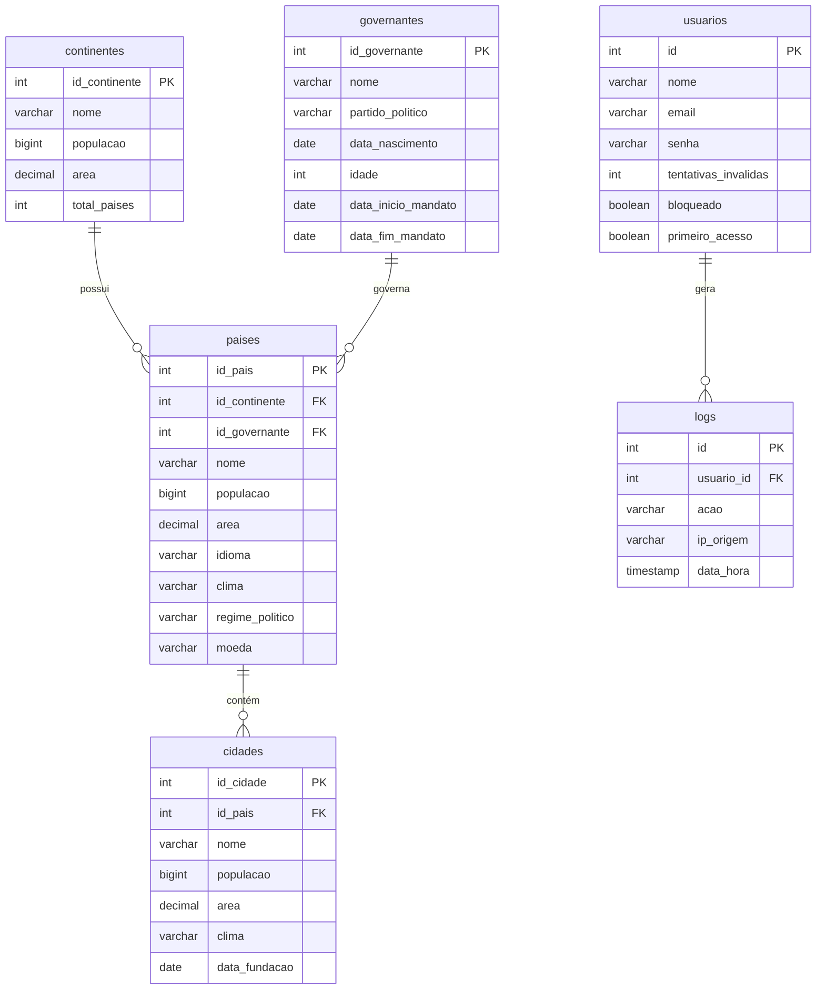

# 🌍 CRUD Mundo

<p>
  <strong>Sistema web para gerenciamento de informações geográficas</strong><br>
  Continentes, países, cidades e governantes em uma aplicação com autenticação, banco de dados e mapa interativo.
</p>

<p>
  
  
  
  
  
  
</p>

---

## 📑 Conteúdo

- [Sobre o projeto](#-sobre-o-projeto)
- [Funcionalidades](#-funcionalidades)
- [Tecnologias](#-tecnologias)
- [Organização do projeto](#-organização-do-projeto)
- [Modelo do banco de dados](#-modelo-do-banco-de-dados)
- [Como executar](#-como-executar)
- [Configuração do Google Maps](#-configuração-do-google-maps)
- [Acesso inicial](#-acesso-inicial)
- [Segurança e configurações](#-segurança-e-configurações)
- [Autor](#-autor)

## 📖 Sobre o projeto

O **CRUD Mundo** é uma aplicação web para organizar informações geográficas por meio de operações de cadastro, consulta, edição e exclusão. O sistema permite gerenciar continentes, países, cidades e governantes, com os dados armazenados em um banco MySQL.

A aplicação também conta com autenticação de usuários, controle de tentativas de login, troca de senha e registro de ações. Como complemento, a página **Mapa da ETEC** apresenta um mapa interativo com a localização da **Etec Prof. Ilza Nascimento Pintus**, em São José dos Campos.

## ✨ Funcionalidades

### Gerenciamento de informações

- **Continentes:** cadastrar, listar, editar e excluir.
- **Países:** cadastrar, listar, editar e excluir; associar a um continente e a um governante.
- **Cidades:** cadastrar, listar, editar e excluir; associar a um país.
- **Governantes:** cadastrar, listar, editar e excluir.

### Autenticação e auditoria

- Login e logout de usuários.
- Bloqueio de conta após três tentativas de senha incorretas.
- Troca obrigatória de senha no primeiro acesso.
- Alteração de senha com confirmação da senha atual.
- Registro de ações de autenticação e alteração de senha em logs, com data, hora e IP.

### Mapa

- Exibição de mapa interativo com a Google Maps JavaScript API.
- Marcador na sede da Etec Prof. Ilza Nascimento Pintus.
- Coordenadas definidas na página do mapa.

## 🧰 Tecnologias

| Tecnologia | Utilização |
|---|---|
| PHP | Processamento no servidor e operações com o banco de dados |
| MySQL | Armazenamento e relacionamento dos dados |
| HTML5 | Estrutura das páginas |
| CSS3 | Apresentação e adaptação da interface |
| JavaScript | Interações da interface e inicialização do mapa |
| Google Maps JavaScript API | Mapa interativo da unidade escolar |
| Git e GitHub | Controle de versão e hospedagem do código |

## 🗂️ Organização do projeto

```text
CrudMundo/
├── cidades/                 # Operações de cadastro, consulta, edição e exclusão
├── config/
│   └── google_maps.php      # Lê a chave do Maps a partir do .env
├── continentes/             # Operações de continentes
├── css/
│   ├── mapa.css             # Estilos específicos do mapa
│   └── style.css            # Estilos gerais
├── database/
│   └── bd_mundo.sql         # Criação das tabelas e usuário inicial
├── governantes/             # Operações de governantes
├── includes/
│   ├── auth.php             # Verificação de autenticação
│   └── conexao.php          # Conexão com o MySQL
├── js/
│   └── script.js            # Interações JavaScript
├── paises/                  # Operações de países
├── .env.example             # Modelo das configurações locais
├── .gitignore               # Arquivos não enviados ao Git
├── alterar_senha.php        # Alteração voluntária da senha
├── index.php                # Página inicial
├── login.php                # Autenticação
├── logout.php               # Encerramento da sessão
├── mapa.php                 # Mapa da ETEC
└── trocar_senha.php         # Troca obrigatória no primeiro acesso
```

## 🗄️ Modelo do banco de dados

O script `database/bd_mundo.sql` cria o banco `bd_mundo` e as tabelas de continentes, países, cidades, governantes, usuários e logs.



O banco relaciona países a continentes e governantes, cidades a países e logs a usuários. A exclusão de um país apaga em cascata as cidades relacionadas, conforme a regra definida no SQL.

## 🚀 Como executar

### Requisitos

- PHP com a extensão **MySQLi** habilitada.
- MySQL ou MariaDB.
- Servidor local, como XAMPP ou WampServer.
- Navegador com acesso à internet para carregar o Google Maps.
- Projeto do Google Cloud com a Maps JavaScript API ativada e uma chave configurada.

### Instalação no XAMPP

1. Baixe o repositório pelo GitHub e extraia os arquivos.
2. Copie a pasta `CrudMundo` para o diretório `htdocs` do XAMPP.
3. Abra o XAMPP e inicie **Apache** e **MySQL**.
4. Acesse `http://localhost/phpmyadmin`.
5. Importe o arquivo `CrudMundo/database/bd_mundo.sql`.
6. Na pasta `CrudMundo`, faça uma cópia de `.env.example` e nomeie a cópia `.env`.
7. Edite o `.env` com os dados do seu MySQL e a chave do Google Maps. Exemplo:

   ```ini
   DB_HOST=localhost
   DB_USER=root
   DB_PASS=
   DB_NAME=bd_mundo
   GOOGLE_MAPS_API_KEY=SUA_CHAVE_API
   ```

8. Acesse `http://localhost/CrudMundo` e selecione **Mapa da ETEC** no menu.

> O `.env` deve ficar na pasta `CrudMundo`, ao lado de `.env.example`. Ele é lido pelo PHP e não deve ser enviado ao GitHub.

## 🗺️ Configuração do Google Maps

A página `mapa.php` carrega a **Maps JavaScript API** usando a chave definida em `GOOGLE_MAPS_API_KEY`.

Para configurar a API:

1. Crie ou selecione um projeto no Google Cloud Console.
2. Ative a **Maps JavaScript API**.
3. Crie uma chave de API.
4. Restrinja a chave à API utilizada e aos endereços autorizados para o teste, como `http://localhost/*`.
5. Adicione a chave ao arquivo `.env` local.

O Google Cloud pode exigir que o projeto tenha faturamento configurado. Confira as condições exibidas no Console. A chave é enviada ao navegador para carregar o mapa; as restrições de API e de endereço ajudam a limitar onde ela pode ser usada.

Referências oficiais:

- [Carregar a Maps JavaScript API](https://developers.google.com/maps/documentation/javascript/load-maps-js-api)
- [Erros e solução de problemas](https://developers.google.com/maps/documentation/javascript/error-messages)

## 🔐 Segurança e configurações

- O arquivo `.env` contém configurações locais e não deve ser enviado ao GitHub.
- O arquivo `.env.example` deve conter apenas valores demonstrativos, nunca uma chave real.
- Cada pessoa que executar o projeto deve configurar seu próprio `.env`.
- Restrinja a chave da API no Google Cloud aos serviços e endereços necessários.
- A chave é visível no navegador quando o mapa é carregado; não a trate como um segredo oculto do lado do cliente.

## 👤 Acesso inicial

O script SQL cria um usuário administrador inicial e exige a troca de senha no primeiro acesso. Os dados da conta inicial estão indicados no arquivo `database/bd_mundo.sql`.

## ✍️ Autor

Desenvolvido por **Gabriel Henrique da Silva**, estudante do curso de Desenvolvimento de Sistemas da **Etec Prof. Ilza Nascimento Pintus**, em São José dos Campos.

---
