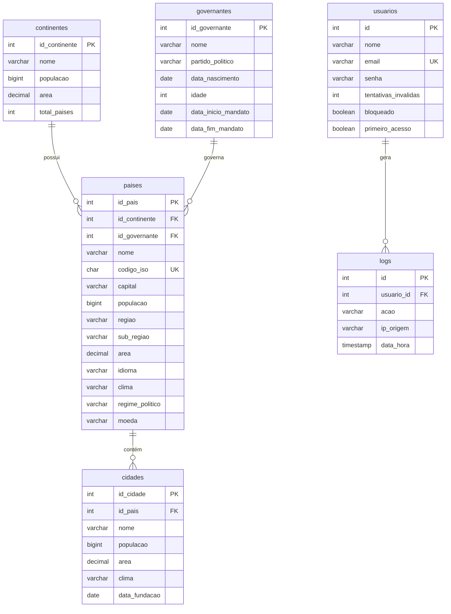

# 🌍 CRUD Mundo

<p align="center">
  <strong>Gerenciamento de informações geográficas com PHP, MySQL e APIs externas</strong><br>
  Cadastre e consulte dados de continentes, países, cidades e governantes — e importe dados de países pela REST Countries API.
</p>

<p align="center">
  
  
  
  
  
  
  
</p>

---

## 📑 Navegação

[Sobre](#-sobre-o-projeto) · [Funcionalidades](#-funcionalidades) · [Tecnologias](#-tecnologias) · [Estrutura](#-estrutura-do-projeto) · [Banco de dados](#-modelo-do-banco-de-dados) · [Instalação](#-como-executar) · [APIs](#-integrações-com-apis) · [Segurança](#-segurança) · [Autor](#-autor)

## 📖 Sobre o projeto

O **CRUD Mundo** é uma aplicação web para gerenciar informações geográficas. Além das operações de cadastro, consulta, edição e exclusão, o sistema possui autenticação de usuários, controle de tentativas de login, alteração de senha e registro de ações.

A funcionalidade de importação de países demonstra a integração entre uma aplicação PHP e um serviço externo: o sistema consulta a **REST Countries API** via HTTP GET, interpreta a resposta JSON e grava os dados selecionados no banco MySQL com uma instrução parametrizada via PDO.

A aplicação também apresenta um mapa da localização da **Etec Prof. Ilza Nascimento Pintus**, em São José dos Campos, usando a Google Maps JavaScript API.

## ✨ Funcionalidades

### CRUD Mundo

- Cadastro, listagem, edição e exclusão de continentes.
- Cadastro, listagem, edição e exclusão de países.
- Cadastro, listagem, edição e exclusão de cidades associadas a países.
- Cadastro, listagem, edição e exclusão de governantes.
- Relacionamentos entre continentes, países, cidades e governantes.

### Autenticação

- Login e logout.
- Bloqueio da conta após três tentativas de senha incorretas.
- Troca obrigatória de senha no primeiro acesso.
- Alteração de senha com confirmação da senha atual.
- Registro de ações de autenticação e alteração de senha em logs.

### Importação via REST Countries API

- Busca de um país pelo nome comum.
- Consulta remota via HTTP GET com cURL.
- Interpretação e validação da resposta JSON.
- Verificação de duplicidade pelo código ISO alpha-2.
- Gravação no MySQL com PDO e parâmetros preparados.
- Exibição dos países importados na listagem de países.

Os campos importados são nome comum, código ISO alpha-2, capital, população, região e sub-região. Como esses dados não incluem o continente cadastrado nem o governante, os relacionamentos correspondentes permanecem sem associação até serem definidos no CRUD.

### Mapa

- Mapa interativo com marcador na localização da Etec Prof. Ilza Nascimento Pintus.
- Coordenadas fixas no código da página do mapa para fins da atividade.

## 🧰 Tecnologias

| Tecnologia | Uso no projeto |
|---|---|
| PHP | Lógica de servidor e processamento de formulários |
| MySQL | Persistência e relacionamento dos dados |
| MySQLi | Conexão utilizada pelos módulos CRUD existentes |
| PDO | Conexão e INSERT parametrizado na importação via API |
| cURL | Requisição HTTP à REST Countries API |
| JSON | Formato da resposta recebida da API |
| HTML5 e CSS3 | Estrutura e apresentação da interface |
| JavaScript | Interações da interface e inicialização do mapa |
| Google Maps JavaScript API | Mapa interativo da ETEC |

## 🗂️ Estrutura do projeto

```text
CrudMundo/
├── cidades/                         # CRUD de cidades
├── config/
│   ├── api.php                       # Chave da REST Countries lida do .env
│   └── google_maps.php               # Chave do Google Maps lida do .env
├── continentes/                      # CRUD de continentes
├── css/
│   ├── mapa.css                      # Estilos específicos do mapa
│   └── style.css                     # Estilos gerais
├── database/
│   ├── bd_mundo.sql                  # Estrutura inicial e dados do banco
│   └── migracao_api_countries.sql    # Colunas necessárias à importação pela API
├── governantes/                      # CRUD de governantes
├── includes/
│   ├── auth.php                      # Proteção das páginas autenticadas
│   ├── conexao.php                   # Conexão MySQLi usada pelo CRUD existente
│   └── conexao_pdo.php               # Conexão PDO usada pela importação
├── js/
│   └── script.js                     # Interações JavaScript
├── paises/
│   ├── importar.php                  # Formulário de busca na API
│   ├── importar_pais.php             # Consulta API, valida e grava com PDO
│   └── ...                           # Demais páginas do CRUD de países
├── .env.example                      # Modelo das configurações locais
├── .gitignore                        # Arquivos locais ignorados pelo Git
├── index.php                         # Página inicial
└── mapa.php                          # Mapa da ETEC
```

## 🗄️ Modelo do banco de dados

O banco `bd_mundo` possui seis tabelas. Os campos `codigo_iso`, `capital`, `regiao` e `sub_regiao` foram adicionados à tabela `paises` para armazenar os dados importados da API.



### Atualizar um banco já existente

Se você **já tinha importado** o banco antes desta atividade, execute uma única vez `database/migracao_api_countries.sql` no phpMyAdmin. Se estiver criando o banco do zero, importe apenas `database/bd_mundo.sql`, que já inclui as colunas novas.

## 🚀 Como executar

### Requisitos

- PHP **7.3 ou superior**, com as extensões **MySQLi**, **PDO MySQL**, **cURL** e **mbstring** habilitadas.
- MySQL ou MariaDB.
- Servidor local, como XAMPP ou WampServer.
- Acesso à internet para consultar as APIs.

### Instalação com XAMPP

1. Baixe ou clone o repositório e copie a pasta `CrudMundo` para `C:\xampp\htdocs\CrudMundo`.
2. No painel do XAMPP, inicie **Apache** e **MySQL**.
3. Abra `http://localhost/phpmyadmin`.
4. Para um banco novo, importe `CrudMundo/database/bd_mundo.sql`. Para um banco antigo, aplique apenas a migração descrita acima.
5. Na pasta `CrudMundo`, copie `.env.example` para um arquivo chamado `.env`.
6. Configure no `.env` os dados locais do MySQL e as chaves das APIs, conforme a seção abaixo.
7. Acesse `http://localhost/CrudMundo`.

## 🔌 Integrações com APIs

### REST Countries API

Na tela **Países**, escolha **Importar pela API REST Countries**, informe o nome comum do país e envie o formulário. O PHP consulta a API pelo endpoint `/countries/v5/names.common/{nome}`; em seguida, valida os dados recebidos e grava o país no banco.

A API usa um token Bearer. A chave de demonstração `rc_live_demo` permite experimentar a estrutura da resposta, mas retorna um país de exemplo (atualmente, Canadá), que pode não corresponder ao nome pesquisado. Para importar dados do país solicitado, obtenha uma chave própria na [documentação da REST Countries](https://restcountries.com/docs/countries) e configure-a no `.env`.

### Google Maps

A página `mapa.php` carrega a Google Maps JavaScript API para mostrar a ETEC. Ative essa API no Google Cloud e configure a chave conforme a [documentação oficial de carregamento](https://developers.google.com/maps/documentation/javascript/load-maps-js-api).

### Variáveis de ambiente

Use o `.env.example` como modelo. Um `.env` local pode ficar assim:

```ini
DB_HOST=localhost
DB_USER=root
DB_PASS=
DB_NAME=bd_mundo
GOOGLE_MAPS_API_KEY=SUA_CHAVE_DO_GOOGLE_MAPS
REST_COUNTRIES_API_KEY=rc_live_demo
```

Substitua os valores de acordo com o seu ambiente. O `.env` deve ficar na raiz de `CrudMundo`, junto ao `.env.example`; ele não deve ser enviado ao GitHub.

> **Atenção ao Google Maps:** o Google Cloud pode exigir faturamento para ativar a Maps JavaScript API. Verifique as condições da sua conta. A chave do Maps é enviada ao navegador para carregar o mapa; restrinja-a à API e aos endereços necessários. Já o token da REST Countries é usado no servidor PHP, no cabeçalho da requisição cURL.

## ✅ Testes manuais sugeridos

| Cenário | Resultado esperado |
|---|---|
| Importar um país ainda não cadastrado | Dados validados e registro inserido |
| Importar novamente o mesmo país | Mensagem de que o país já está cadastrado |
| Informar um nome inexistente | Mensagem de país não encontrado, sem INSERT |
| API indisponível ou chave recusada | Mensagem de erro, sem gravação no banco |
| Abrir a listagem após importar | País aparece com código ISO, capital e região |

## 🔐 Segurança

- Não versione o arquivo `.env`; ele pode conter credenciais e configurações locais.
- Mantenha apenas valores demonstrativos no `.env.example`.
- Restrinja a chave do Google Maps no Google Cloud aos serviços e endereços necessários.
- O token da REST Countries não é enviado ao navegador; o PHP o utiliza no servidor.
- A importação valida os valores recebidos e usa consultas PDO preparadas para gravar no MySQL.

## 👤 Autor

Desenvolvido por **Gabriel Henrique da Silva**, estudante do curso de Desenvolvimento de Sistemas da **Etec Prof. Ilza Nascimento Pintus**, em São José dos Campos.
