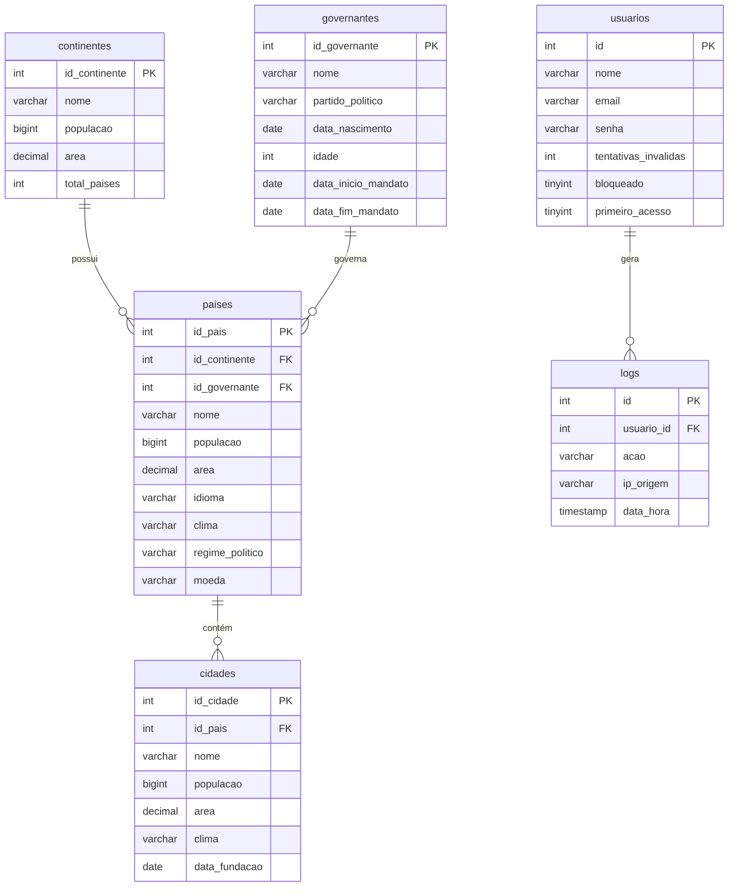

# 🌍 CRUD Mundo


> Sistema web para gerenciamento de informações geográficas, com operações CRUD, autenticação de usuários e mapa interativo da Etec Prof. Ilza Nascimento Pintus.

---

## 📖 Sobre o projeto

O **CRUD Mundo** é uma aplicação web desenvolvida para cadastrar e administrar informações sobre continentes, países, cidades e governantes. O sistema combina uma interface web com processamento em PHP e armazenamento em MySQL.

Além das operações de cadastro, consulta, edição e exclusão, o projeto possui autenticação, controle de tentativas de login, alteração de senha e registro de ações. A página **Mapa da ETEC** utiliza a Google Maps JavaScript API para exibir a localização da Etec Prof. Ilza Nascimento Pintus, em São José dos Campos.

## ✨ Funcionalidades

### Gerenciamento de dados

- Cadastro, consulta, edição e exclusão de continentes.
- Cadastro, consulta, edição e exclusão de países.
- Cadastro, consulta, edição e exclusão de cidades associadas a países.
- Cadastro, consulta, edição e exclusão de governantes associados a países.

### Acesso e segurança

- Login e logout de usuários.
- Bloqueio da conta após três tentativas de senha incorretas.
- Troca obrigatória de senha no primeiro acesso.
- Alteração de senha com confirmação da senha atual.
- Registro de ações de autenticação e alteração de senha em logs.

### Mapa

- Mapa interativo da Etec Prof. Ilza Nascimento Pintus, em São José dos Campos.
- Marcador posicionado na localização da unidade usando a Google Maps JavaScript API.

## 🧰 Tecnologias utilizadas

- **PHP** — processamento no servidor e integração com o banco de dados.
- **MySQL** — armazenamento e relacionamento dos dados.
- **HTML5 e CSS3** — estrutura e apresentação das páginas.
- **JavaScript** — interações da interface e inicialização do mapa.
- **Google Maps JavaScript API** — exibição do mapa.
- **Git e GitHub** — controle de versão e hospedagem do código.

## 🗃️ Modelo do banco de dados

O banco `bd_mundo` é composto por seis tabelas:



O relacionamento entre países e cidades utiliza uma chave estrangeira. No banco, a exclusão de um país remove as cidades associadas a ele em cascata.

## 📁 Estrutura do projeto

```text
CrudMundo/
├── cidades/                 # Operações de cidades
├── config/
│   └── google_maps.php      # Carrega a chave do Maps a partir do .env
├── continentes/             # Operações de continentes
├── css/
│   ├── mapa.css             # Estilos da página do mapa
│   └── style.css            # Estilos gerais
├── database/
│   └── bd_mundo.sql         # Criação do banco e usuário inicial
├── governantes/             # Operações de governantes
├── includes/
│   ├── auth.php             # Proteção das páginas autenticadas
│   └── conexao.php          # Conexão com MySQL
├── js/
│   └── script.js            # Interações da interface
├── paises/                  # Operações de países
├── .env.example             # Modelo de configuração local
├── .gitignore               # Arquivos ignorados pelo Git
├── alterar_senha.php        # Alteração de senha
├── index.php                # Página inicial
├── login.php                # Login
├── logout.php               # Logout
├── mapa.php                 # Mapa da ETEC
└── trocar_senha.php         # Troca obrigatória no primeiro acesso
```

## 🚀 Como executar

### Requisitos

- PHP com a extensão **MySQLi** habilitada.
- MySQL ou MariaDB.
- Um servidor local, como XAMPP ou WampServer.
- Acesso à internet para carregar o Google Maps.
- Uma chave configurada para a **Maps JavaScript API**.

### Instalação

1. Baixe ou clone o repositório.
2. Copie a pasta `CrudMundo` para o diretório do servidor local. No XAMPP, use `htdocs`.
3. Inicie os serviços **Apache** e **MySQL**.
4. Acesse o phpMyAdmin e importe `CrudMundo/database/bd_mundo.sql`.
5. Faça uma cópia de `CrudMundo/.env.example` e nomeie-a `.env`, na própria pasta `CrudMundo`.
6. Configure no `.env` os dados de conexão do MySQL e a chave da API:

   ```ini
   DB_HOST=localhost
   DB_USER=root
   DB_PASS=
   DB_NAME=bd_mundo
   GOOGLE_MAPS_API_KEY=SUA_CHAVE_API
   ```

7. No Google Cloud Console, selecione ou crie um projeto, ative a **Maps JavaScript API** e crie uma chave.
8. Configure as restrições da chave conforme o ambiente de execução, incluindo a API necessária e os endereços locais autorizados.
9. Abra `http://localhost/CrudMundo` no navegador e acesse **Mapa da ETEC** pelo menu.

> O Google Cloud pode exigir uma conta de faturamento para ativar a API. Confira as condições e as cotas exibidas na sua conta.

## 🔐 Configuração da chave e do `.env`

O arquivo `.env` contém configurações locais e **não deve ser enviado ao GitHub**. O arquivo `.env.example` serve apenas como modelo e não deve conter a chave real.

A chave do Maps JavaScript API é enviada ao navegador para que o mapa seja carregado. Por isso, restrinja a chave no Google Cloud aos serviços e endereços necessários. Cada ambiente — por exemplo, o computador do aluno ou o do professor — pode configurar sua própria chave no `.env`.

## 👤 Autor

Desenvolvido por **Gabriel Henrique da Silva**, estudante do curso de Desenvolvimento de Sistemas da **Etec Prof. Ilza Nascimento Pintus**, em São José dos Campos.

---
